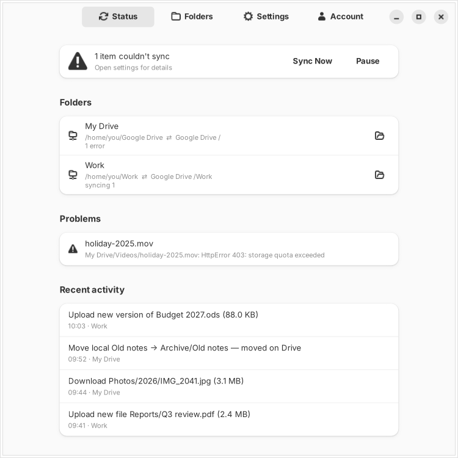
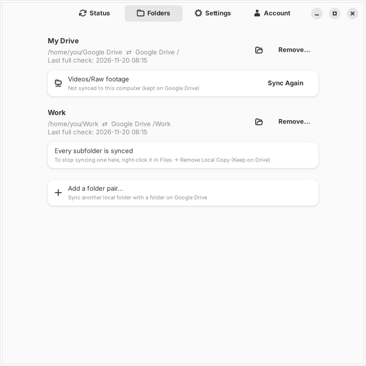
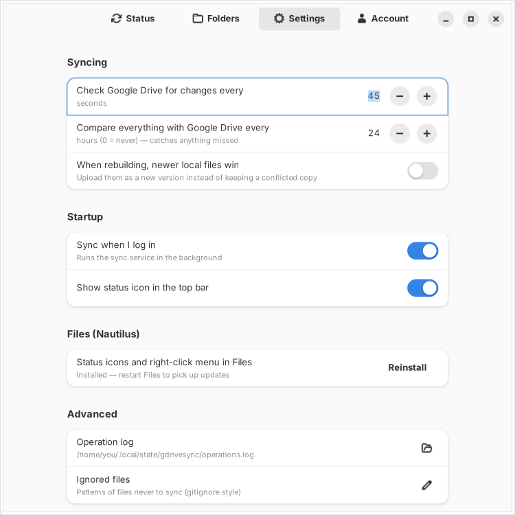

# gdrive-linux-sync

Dropbox-style Google Drive sync for Ubuntu, with Nautilus integration.
Personal project — see [docs/DESIGN.md](docs/DESIGN.md).

**Status:** milestones 1–4 done — two-way sync of one or more folder pairs as a background
service, Nautilus integration, a top-bar status icon and a settings window. Hardening and
packaging are next.

## Setup

1. In [Google Cloud Console](https://console.cloud.google.com/): create a project,
   enable the **Google Drive API**, configure the OAuth consent screen
   (External, add yourself as a test user), and create an OAuth client of type
   **Desktop app**. Download the JSON to `~/.config/gdrivesync/client_secret.json`.
2. Install:
   ```sh
   pipx install -e .        # or: python3 -m venv .venv && .venv/bin/pip install -e '.[dev]'
   ```
3. Choose what to sync — one or more **pairs** of local folder ⇄ Drive folder:
   ```sh
   gdrivesync login
   gdrivesync ls /                              # browse Drive (ls /Work, ls <id>, …)
   gdrivesync pair add ~/'Google Drive' /       # all of My Drive…
   # …or separate folders instead (pairs can't overlap):
   gdrivesync pair add ~/Work /Work
   gdrivesync pair add ~/Pictures/Phone /Photos/Phone --create
   gdrivesync pair list
   gdrivesync pull --dry-run                    # preview the first download
   gdrivesync sync                              # one two-way pass for every pair, then exit
   ```
4. Run it in the background:
   ```sh
   mkdir -p ~/.config/systemd/user
   cp packaging/systemd/gdrivesync.service ~/.config/systemd/user/
   systemctl --user daemon-reload
   systemctl --user enable --now gdrivesync
   journalctl --user -u gdrivesync -f      # watch what it's doing
   ```
   The service runs the initial `pull` itself if you haven't yet.

> Note: with the consent screen in "Testing" mode, refresh tokens expire after
> 7 days. Publishing the app to "In production" (unverified is fine for
> personal use) avoids that; you'll just see an "unverified app" warning once.

## Nautilus (Files) integration

```sh
sudo apt install python3-nautilus     # once: lets Nautilus load Python extensions
gdrivesync install-desktop            # extension, file types, sidebar bookmarks
nautilus -q                           # restart Files to load it
```

With the service running, items in your synced folders get:

- **an emblem** — ✓ up to date, ⟳ syncing, ! error or conflicted copy — and a
  **"Sync status" column** in list view (right-click the column header to add it);
- **right-click → Open in Google Drive / Copy Google Drive Link**;
- on sub-folders, **Remove Local Copy (Keep on Drive)…** — selective sync, after
  a confirmation (undo with `gdrivesync exclude remove <path>`);
- on the folder background, **Sync with Google Drive Now**.

Double-clicking a `.gdoc` / `.gsheet` / `.gslides` file opens it in your browser
(`gdrivesync open <file>` does the same from a terminal). Each synced folder also gets a
sidebar bookmark. `gdrivesync install-desktop --uninstall` removes all of it.

If emblems don't appear, check the service is running (`systemctl --user status
gdrivesync`) and that Nautilus loaded the extension (`nautilus -q`, then reopen it).

## Status icon and settings window

```sh
sudo apt install python3-gi gir1.2-gtk-4.0 gir1.2-adw-1 gir1.2-gtk-3.0 \
                 gir1.2-ayatanaappindicator3-0.1      # usually already there on Ubuntu
gdrivesync install-desktop      # also adds the app to the grid + status icon at login
gdrivesync tray &               # start the status icon now
gdrivesync settings             # or open "Google Drive Sync" from the app grid
```

The **status icon** shows whether everything is up to date, syncing, paused, has a problem,
or the service isn't running. Its menu opens your folders, syncs now, pauses/resumes, lists
recent activity and opens settings. You get a desktop notification when a file was edited in
two places (and a conflicted copy was kept), when something can't sync, or when the service
stops.

The **settings window**:

| Status | Folders | Settings |
|---|---|---|
|  |  |  |

- **Status** — overall state, Sync Now / Pause, each folder, problems, recent activity.
- **Folders** — add or remove folder pairs; bring back folders you stopped syncing locally.
- **Settings** — how often to check Drive, the daily full check, the rebuild conflict rule,
  sync and status icon at login, Files integration, operation log and ignore file.
- **Account** — who you're signed in as, storage, sign in again.

Changes go through the same `gdrivesync` commands described below. Some settings need the
service restarted; the window offers a button for that.

## What `pull` does

- Mirrors each pair's Drive folder into its local folder, 4 downloads in parallel,
  verifying each file's MD5 and setting its modified time to Drive's.
- Google Docs/Sheets/Slides become small `.gdoc`/`.gsheet`/`.gslides` JSON files with the link.
- Re-running is cheap: unchanged files are skipped, renames/moves on Drive become local renames.
- A local file that differs from Drive is **never overwritten** — it's renamed to
  `name (conflicted copy <date>).ext` and the Drive version is downloaded.
- `pull` itself is download-only; `sync` / the service do both directions.

## Configuration

| What | How |
|---|---|
| Folders to sync | `gdrivesync pair add/remove/list` |
| Skip a subfolder (selective sync) | `gdrivesync exclude add ~/Google\ Drive/Videos` — removes the local copy on the next sync (it stays on Drive; waits for any not-yet-uploaded changes inside first). `exclude remove <path>` brings it back, `exclude list` shows them. |
| Ignore files by pattern | `~/.config/gdrivesync/ignore` (gitignore-style) |
| How often to check Drive | `gdrivesync config --poll-interval 30` (seconds, default 45) |
| Parallel downloads in `pull` | `gdrivesync config --max-transfers 8` |
| Full comparison with Drive | `gdrivesync config --full-check-hours 12` (default 24, `0` = off). Run one now: `gdrivesync sync --full` (add `--dry-run` to preview) |

Everything lives in `~/.config/gdrivesync/settings.json`; restart the service after
changes (`systemctl --user restart gdrivesync`). Older single-folder configs are
migrated automatically to a pair called "My Drive".

## Other devices and missed changes

Your phone, the web and other computers all change the same Drive; their changes arrive
through Drive's change feed within one poll interval. Two safety nets cover the feed itself:

- **Rejected feed position** (e.g. after restoring an old backup of the sync state): detected
  automatically. The service compares the whole folder with Drive, applies the differences
  with the usual rules (local edits kept, conflicts → conflicted copies, nothing re-downloaded
  that hasn't changed), and continues from a fresh position. If Drive rejects it again within
  10 minutes the service stops retrying and logs an error instead of re-listing Drive in a loop.
- **Daily full check**: every 24 h each pair is compared with Drive in full. If that finds
  anything the feed missed, it's applied and a warning is logged
  (`journalctl --user -u gdrivesync | grep "full check"`). `gdrivesync pair list` shows when
  each pair was last checked.

## Lost or corrupted sync state

The per-pair sync state lives in `~/.local/share/gdrivesync/pair-*.db`. If it's deleted
(or you reinstall and wiped that folder), the service rebuilds it on start; if it's
**corrupted**, that's detected when it's opened — or mid-run — and the damaged file is
kept as `pair-*.db.corrupt-<date>` while the pair is rebuilt. No crash loops.

A rebuild compares your local folder with Drive instead of downloading everything:

| Local file… | Result |
|---|---|
| identical to Drive | kept (checksum match), not downloaded |
| missing | downloaded |
| different from Drive | kept as a conflicted copy, Drive's version downloaded — or, with *prefer newer*, uploaded as a new version if it's the newer one (Drive keeps the old version in its history) |
| not on Drive, but in Drive's **trash** (same folder, name, content) | it was deleted on Drive → moved to your local trash, not re-uploaded |
| not on Drive at all | uploaded by the next sync (listed first; Drive's trash is emptied after ~30 days, so older deletions can't be told apart from new files) |
| a `.gdoc`-style link to a document that's gone | moved to your local trash |

Rebuild by hand (stop the service first; the command refuses while it runs):

```sh
gdrivesync pair rebuild "My Drive" --dry-run        # preview
gdrivesync pair rebuild "My Drive"                  # differing files → conflicted copies
gdrivesync pair rebuild "My Drive" --prefer-newer   # newer local files → new versions on Drive
gdrivesync config --prefer-newer-on-rebuild on      # use that for automatic rebuilds too
```

*Prefer newer* is off by default: it trusts file timestamps, and a restore with tools
that reset them (e.g. `cp` without `-p`) would make old copies look newest. Drive's version
history can undo it, but conflicted copies are the zero-risk option.

The service and the commands that change things (`sync`, `pull`, `pair rebuild`,
`pair remove`, `doctor --fix`) take a per-pair lock, so they never work on the same folder
at once; read-only commands (`--dry-run`, `log`, `pair list`) always work.

## Dry run and operation log

```sh
gdrivesync sync --dry-run           # every change it *would* make, both directions; changes nothing
gdrivesync sync --dry-run --pair Work
gdrivesync pull --dry-run           # same, for the initial download only
gdrivesync log                      # last 50 operations actually performed
gdrivesync log -f                   # follow live (like tail -f)
gdrivesync log -n 0 --pair Work     # everything for one pair
gdrivesync log --json | jq .        # raw records
```

The dry run uses the real sync logic on a throwaway copy of the sync state: Drive is
only read and your local files aren't touched. Example output:

```
== My Drive: /home/you/Google Drive ⇄ Drive /  (dry run)
  would download Docs/report.pdf (1.2 MB)
  would move local Old -> Renamed — moved on Drive
  would upload new file Notes/todo.txt (312 B)
  would trash on Drive old-draft.txt — deleted locally
4 operation(s) would be performed. Nothing was changed.
```

Every change made by `pull`, `sync`, `doctor --fix` or the service is appended as a JSON
line to `~/.local/state/gdrivesync/operations.log` (rotated at 10 MB, 5 old files kept)
and also appears in the service's journal.

## How two-way sync behaves

| You do | Result |
|---|---|
| Add / edit / delete a file locally | Uploaded / updated / moved to Drive's trash |
| Rename or move a file or folder locally | Renamed/moved on Drive (no re-upload) |
| Change something on drive.google.com | Applied locally within ~45 s (configurable `poll_interval_s`) |
| Edit the same file on both sides | Drive's version wins the name; yours is kept as `… (conflicted copy …)` and uploaded too |
| Edit on one side, delete on the other | The edit wins; the file comes back |
| Rename/delete a `.gdoc` link file | Renames / trashes the Google Doc |

Safety nets: deleted files go to the desktop trash or Drive's trash, never straight to
oblivion; the service refuses to sync deletions if the sync folder is missing, or if more
than half (and over 100) of your files vanish at once — run
`gdrivesync sync --allow-mass-delete` if that was intentional. Files still being written
(modified in the last few seconds) are uploaded once they settle.

Interrupted uploads (crash, power loss, network drop) are resumed under the same
Drive file id, so they never leave duplicates. To check for and clean up any
duplicates from other causes: `gdrivesync doctor` (add `--fix` to trash them).

Ignored by default: `*.part *.swp *.tmp *~ ~$* .~lock.*# .#* .goutputstream-* .directory`.
Add your own patterns (gitignore-style) to `~/.config/gdrivesync/ignore`.

## Tests

```sh
pytest
```
