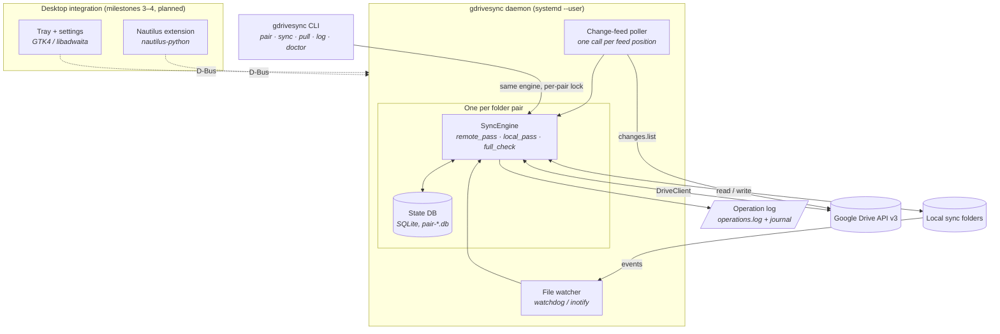

# gdrive-linux-sync — Design

A Dropbox-style Google Drive sync client for Ubuntu/GNOME, with Nautilus
integration. Personal-use tool.

## Scope (v1)

| In scope | Out of scope (for now) |
|---|---|
| **My Drive** only | Shared Drives, "Shared with me" |
| **Full mirror** of My Drive (minus excluded folders) | On-demand / placeholder files (would need FUSE) |
| Two-way sync with conflict copies | Real-time collaboration, Office conversion |
| Nautilus status icons + context menu | Flatpak/Snap packaging |
| Tray icon + small settings window | Public distribution / Google app verification |
| All Python | |

Because this is personal use, each install uses **the user's own OAuth client ID**
(created in Google Cloud Console as a "Desktop app"). That avoids Google's
restricted-scope verification for the full `drive` scope.

## Architecture



The CLI and the daemon use the same `SyncEngine`; a per-pair lock keeps them from
working on one folder at the same time. Dashed lines are planned.

### Python environments

- **Daemon + CLI** (`src/gdrivesync`): installed in its own venv (e.g. `pipx`),
  free to use PyPI deps (`google-api-python-client`, `google-auth-oauthlib`,
  `watchdog`, ...).
- **Nautilus extension** (`nautilus/`): runs *inside Nautilus' process* with the
  system Python. It must only use `gi` (PyGObject) from Ubuntu's packages —
  no PyPI deps. It talks to the daemon purely over D-Bus.
- **Tray/settings UI**: system Python + PyGObject (GTK4, libadwaita,
  AyatanaAppIndicator3). Also D-Bus only.

### Daemon components

1. **Auth** (`auth.py`) — `InstalledAppFlow` loopback flow. Client secret at
   `~/.config/gdrivesync/client_secret.json`; token at
   `~/.local/share/gdrivesync/token.json` (mode 0600). Could move to libsecret
   later.
2. **Drive client** (`drive.py`) — thin wrapper over Drive v3: listing,
   `changes.list` paging, downloads, resumable uploads, retry with exponential
   backoff on 403 `rateLimitExceeded`/`userRateLimitExceeded`, 429, 5xx.
3. **State DB** (`state.py`) — SQLite at `~/.local/share/gdrivesync/state.db`.
   One row per synced item recording the *last agreed state* ("base") of both
   sides. This is what makes three-way reconciliation possible.
4. **Remote poller** — every 30–60 s calls `changes.list(pageToken)`; persists
   the new `startPageToken` only after changes are applied.
5. **Local watcher** — `watchdog` (inotify) for live events, debounced; plus a
   periodic full rescan (inotify can overflow / hit `max_user_watches`).
6. **Reconciler** — for each item compare *local*, *remote* and *base*:

   | Local vs base | Remote vs base | Action |
   |---|---|---|
   | same | same | nothing |
   | changed | same | upload |
   | same | changed | download |
   | changed | changed | if contents equal (md5) → just update base; else **conflict** |
   | deleted | same | trash remotely |
   | same | deleted/trashed | delete locally (move to local trash) |
   | deleted | changed | re-download (edit wins over delete) |
   | changed | deleted | re-upload (edit wins over delete) |

   Conflict: keep remote as the canonical name, rename local to
   `name (conflicted copy YYYY-MM-DD HHMM).ext` and upload it.
7. **Transfer queue** — bounded worker pool (default 4); downloads to a temp
   file in `<sync root>/.gdrivesync-tmp/` then atomic `rename`; uploads use
   resumable sessions for files > 5 MB.

### Change detection details

- Remote "changed" = `md5Checksum` (or `headRevisionId`) differs from base;
  rename/move = `name`/`parents` differ.
- Local "changed" = size or mtime differ from base → then hash to confirm
  (avoids spurious uploads after `touch`).
- Local renames: inotify `MOVED_FROM`/`MOVED_TO` pairs → Drive `files.update`
  with new name/parent (no re-upload). On rescan, unmatched delete+create with
  equal md5 is treated as a move.

### Drive quirks & how we handle them

| Quirk | Handling |
|---|---|
| Google Docs/Sheets/Slides/etc. have no binary content | Write a small `.gdoc`/`.gsheet`/`.gslides` JSON file with the URL; Nautilus "Open" goes to browser. Never uploaded back. |
| Duplicate names in the same folder | Second+ copies get `name (2).ext` locally; mapping is by `fileId`, not name. |
| `/` and other odd characters in names | `/` → `∕` (U+2215) locally, mapped back on upload. |
| Shortcuts (`application/vnd.google-apps.shortcut`) | Skipped in v1 (optionally `.desktop` link later). |
| Multiple parents | Legacy only; use first parent. |
| Files we can't download (abuse flag, no permission) | Mark as error, surface in UI, don't retry forever. |
| Trash | Remote deletes from us go to Drive trash; local deletes from remote go to the freedesktop trash (`gio trash`). |

### Ignore rules

Built-in: `.gdrivesync-tmp/`, `*.part`, `*.swp`, `~$*`, `.~lock.*#`,
`.goutputstream-*`. User patterns in `~/.config/gdrivesync/ignore` (gitignore
syntax). Excluded remote folders (selective sync) stored in config.

## D-Bus API (session bus)

Name `io.github.jvandevelde.GDriveSync`, object `/io/github/jvandevelde/GDriveSync`,
same interface name. Served by `dbus_service.py` (jeepney) on its own thread with
its own read-only DB connection per pair, so status lookups never wait for a
transfer; anything that changes state runs on the sync thread via
`Daemon.call_soon()`. Try it: `busctl --user introspect io.github.jvandevelde.GDriveSync
/io/github/jvandevelde/GDriveSync`.

| Member | Signature | Purpose |
|---|---|---|
| `GetRoots()` | `→ as` | local folders of all pairs |
| `GetFileStatus(path)` | `s → s` | `synced` / `syncing` / `error` / `conflict` / `ignored` / `""` (not ours / missing) |
| `GetFileStatuses(paths)` | `as → a{ss}` | batched |
| `GetDriveLink(path)` | `s → s` | drive.google.com URL (`""` if not on Drive yet) |
| `GetState()` | `→ s` | JSON: paused, per-pair status/errors/active transfers, recent operations |
| `SyncNow()`, `Pause()`, `Resume()` | | |
| `Exclude(path)` / `Include(path)` | `s → s` | selective sync from the file manager; persisted to settings |
| signal `StatusChanged(paths)` | `as` | changed paths **and their ancestor folders** (batched every 0.3 s) |
| signal `StateChanged()` | | paused/resumed |

Status is derived on demand (`status.py`): ignored by rules → `ignored`; in the
engine's error map → `error`; being transferred (engine `active` set) → `syncing`;
"conflicted copy" name → `conflict`; untracked or changed since the last sync →
`syncing`; else `synced`. Folders are `error` if anything inside failed. The
engine notifies listeners on every operation, transfer start/end, and error
set/clear; the daemon maps those to absolute paths for the signal.

## Nautilus extension

`src/gdrivesync/desktop/gdrivesync_nautilus.py`, installed by
`gdrivesync install-desktop` into `~/.local/share/nautilus-python/extensions/`
(needs `python3-nautilus`). System Python + PyGObject only; works with the
Nautilus 4 (GTK 4) and 3 extension APIs.

- **InfoProvider** (`update_file_info_full`, async) — emblem per item
  (`emblem-default`, `emblem-synchronizing`, `emblem-important`) plus a
  **ColumnProvider** "Sync status" column, in case the emblems aren't shown in
  the current view. **Emblem display still to be verified on a real Ubuntu desktop.**
- Tracks the service with `Gio.bus_watch_name`: emblems appear when it starts and
  clear when it stops. `StatusChanged` → `invalidate_extension_info()` on the
  files it has seen (bounded cache).
- **MenuProvider** — single selection inside a synced folder: Open in Google
  Drive, Copy Google Drive Link, and for sub-folders "Remove Local Copy (Keep on
  Drive)…" (confirmation dialog → `Exclude`). Folder background: "Sync with Google
  Drive Now".
- Never blocks: all D-Bus calls are async with a 3 s timeout; no status → no emblem.

`install-desktop` also registers MIME types for the link files
(`application/x-gdrivesync-gdoc`, …) with a hidden handler running
`gdrivesync open %f` (opens the URL in the browser), and adds a sidebar bookmark
per pair. `--uninstall` reverts it.

**Testing:** `tests/test_nautilus_ext.py` runs the real extension on the system
Python (PyGObject) against the real service on a private session bus; only the
Nautilus module itself (interfaces, FileInfo, completion callback) is faked.

## Tray / settings

Two separate processes on the system Python (PyGObject), because
libayatana-appindicator is GTK 3 and the settings window is GTK 4 / libadwaita —
one process can't load both. Launched via `gdrivesync tray` / `gdrivesync
settings`, which `exec` the system Python on `desktop/gdrivesync_*.py` with
`GDRIVESYNC_CLI` pointing back at the CLI. Neither imports the gdrivesync package.

- **Shared:** `ui_common.py` (pure Python: overall-status summary, notification
  rules, autostart entry) and `ui_gio.py` (async Gio D-Bus client following the
  service, non-blocking CLI/systemctl runner, desktop notifications via
  `org.freedesktop.Notifications`).
- **Tray** (`gdrivesync_tray.py`, single instance): icon reflects synced /
  syncing / paused / error / service-not-running. Menu: status line, open each
  folder, Sync now, Pause/Resume, Recent activity, Settings…, and "Start syncing"
  when the service is down. Refreshes on `StatusChanged`/`StateChanged` signals
  (debounced) and every 10 s. Notifies about new conflicts, new errors, and the
  service stopping; never about the state it found at startup.
- **Settings** (`gdrivesync_settings.py`, single instance): Status (overview,
  per-folder state, problems, recent activity), Folders (add/remove pairs,
  re-include excluded folders), Settings (poll interval, full-check interval,
  newer-wins on rebuild, sync at login via `systemctl --user enable`, tray at
  login via an XDG autostart entry, Files integration, log and ignore file),
  Account (whoami, sign in again). Reads: D-Bus `GetState` + `gdrivesync config
  --json`. Writes: the same CLI commands a user would run (so validation and
  per-pair locking are shared); removing a pair stops the service around
  `pair remove` because the service holds the pair's lock. Settings changes show
  a "Restart the sync service" banner.
- **Testing:** `tests/test_gui.py` runs both UIs under Xvfb against the real
  service on a private bus, with recording fakes for the CLI and systemctl and a
  fake notification server; the settings test also saves screenshots.

## Layout

```
src/gdrivesync/
  cli.py             `gdrivesync` command
  config.py          paths, settings, folder pairs
  auth.py            OAuth
  drive.py           Drive API wrapper
  state.py           SQLite state DB, integrity check, per-pair lock
  pull.py            initial download / rebuild
  engine.py          two-way sync engine (+ dry run)
  daemon.py          background service loop
  status.py          per-path sync status
  dbus_service.py    D-Bus API
  oplog.py           operation log
  pairs.py, doctor.py, localfs.py, names.py, desktop_install.py
  desktop/           Nautilus extension + MIME types (installed by install-desktop)
packaging/systemd/   user service unit
tests/
docs/
```

## Implementation notes (milestone 2)

- `engine.py` is **state-based**: `remote_pass()` applies the Drive change feed,
  `local_pass()` scans the tree and diffs against the DB. Both are idempotent, so
  our own writes echoing back (inotify events, Drive changes) are no-ops.
- `daemon.py` runs everything on one thread; the watchdog thread only enqueues.
  Local events are debounced (2 s quiet, max 15 s). Watcher rename events are
  applied directly so renaming a big folder is one API call; a full scan runs
  every 10 min as a safety net (every 60 s if inotify is unavailable). Remote
  polling backs off exponentially on errors.
- Remote items that fail to apply are stored in `kv.remote_retry_ids` and
  re-fetched next pass, so the change-feed position can always advance.
- Offline renames are recovered by matching vanished files to new ones by
  size + MD5 (or by the id inside a `.gdoc` stub).

### Folder pairs

Settings hold a list of pairs `{name, local, remote_path, remote_id,
excluded_folder_ids, db}`; `remote_id = "root"` means all of My Drive. Each pair
gets its own `SyncEngine` and SQLite DB (`~/.local/share/gdrivesync/pair-<name>.db`;
a migrated legacy setup keeps `state.db`). Pairs may not overlap locally or on
Drive (checked by walking each Drive folder's parent chain).

The Drive change feed is account-wide. The daemon groups engines by their saved
feed position and makes one `changes.list` call per distinct position; every
engine in the group applies the same batch and ignores items outside its root
(their parent chain doesn't lead to a folder it tracks). After one poll all
pairs share a position, so it's one call per poll regardless of pair count.
A file moved on Drive from one pair to another is removed from the first and
downloaded into the second. If a pair's own Drive folder is trashed or deleted,
that pair stops with an error instead of mirroring the deletion locally.

### Selective sync (excluded folders)

`reconcile_exclusions()` runs at the start of every local pass:

- **Newly excluded, still synced locally:** if everything inside is on Drive
  (no untracked files, no unsynced edits), the local copy is deleted (not trashed —
  it's all on Drive) and its DB rows dropped. Otherwise it's retried next pass,
  after the pending changes have been uploaded.
- The local path an excluded folder would occupy is remembered
  (`kv.excluded_paths`, updated when it's renamed/moved on Drive). The local scan
  skips that path, so a local folder of the same name is never uploaded as a
  duplicate.
- **Re-included:** the folder is fetched and downloaded with its contents.
- Remote changes inside excluded folders are ignored.

### Change-feed recovery and full checks

`SyncEngine.full_check()` takes a fresh start token, lists the pair's whole tree
(`files.list` for all of My Drive, or a per-folder walk for a subfolder pair), and
feeds it to the same `_apply_remote()` used for the change feed — every listed
item as "current state", every tracked item not listed as "removed". Unchanged
items are metadata-only no-ops. One guard was needed for this: a tracked item
missing locally whose Drive copy hasn't changed is a *pending local deletion*, so
it isn't re-downloaded (the next local pass trashes it on Drive).

- `DriveClient.changes_since()` raises `InvalidPageToken` on HTTP 400/404/410.
  Google documents start tokens as non-expiring, but a token from a restored
  backup, another account, or a corrupted DB is rejected. `remote_pass()` and the
  daemon's shared poll catch it and call `recover_feed()` → `full_check()`. A
  second rejection within 10 min raises `SyncError` instead (no listing loops).
- The daemon runs `full_check()` per pair every `full_check_hours` (default 24)
  after a successful poll, logging a warning if it found differences (drift the
  feed missed). The first check after a pull only starts the clock.

### Sync-state loss, corruption and rebuild

- `StateDB.open_checked()` runs `PRAGMA quick_check` before use. A damaged DB
  (SQLITE_CORRUPT / SQLITE_NOTADB — not e.g. "locked") is renamed to
  `*.corrupt-<ts>` with its -wal/-shm, and a fresh DB is returned. No page token
  → the normal first-sync path runs, which doubles as the rebuild.
- At runtime the daemon checks exceptions with `is_corruption()`; for that pair it
  calls a `rebuild(engine)` callback (quarantine + rebuild + new engine) instead of
  failing every pass. Without a callback, or if the rebuild fails, only that pair is
  paused.
- `pull()` with no sync history (first sync or rebuild) reconciles the existing
  local tree (`_reconcile_existing`): orphaned Docs links are trashed locally;
  local-only files that match an item in Drive's trash by (parent, name, MD5) — and
  folders whose contents all matched — are moved to the local trash; the rest are
  reported as local-only (uploaded by the next local pass). With `prefer_newer`, a
  differing local file more than 2 s newer than Drive's `modifiedTime` is recorded
  with Drive's metadata but `local_mtime_ns = -1`, so the engine's normal
  "modified locally" path uploads it as a new revision of the same Drive file.
- `PairLock` (flock on `<db>.lock`) is held by the service for its lifetime and by
  every mutating CLI command, so `pair rebuild` can't swap a DB the service has open.

### Operation log and dry run

All mutations in `SyncEngine` go through a small set of `_fx_*` methods
(download, write_link, mkdir, move_local/conflict, trash_local, delete_local,
create_folder, upload, update, move_remote, trash_remote). Each records an entry
via `OpLog` *after* it succeeds: JSON lines in `$XDG_STATE_HOME/gdrivesync/
operations.log` plus the `gdrivesync.ops` logger. `pull` and `doctor --fix`
record the same way.

Dry run = the same engine with `dry_run=True` on `StateDB.snapshot()` (in-memory
copy). The `_fx_*` methods log "would …" and return synthetic results instead of
acting. To keep later decisions in the same run consistent, the engine keeps a
virtual overlay of simulated local changes (moves, removals, created files) that
`_abs()` and the local scan apply. A test runs a mixed two-way scenario both ways
and asserts the dry run predicted exactly the operations the real run performed.

### Idempotent creates (no duplicates after crashes/retries)

Drive's `files.create` isn't idempotent, so a crash or a retried request after
Drive committed — but before we recorded it — used to leave a duplicate. Now:

1. Get a file id up front from `files.generateIds` (pooled, 20 at a time).
2. Journal `(rel_path, file_id, parent_id)` in `pending_creates` **before** calling Drive.
3. Create with that id. If the call errors but `files.get(id)` finds the file,
   an earlier attempt succeeded — use it (`DriveClient._create_idempotent`).
4. Record the item, then delete the journal row.

At the start of every local pass, leftover journal rows are settled: if the item
was recorded, the row is dropped; if the local file is still there and new, the
pass resumes with the same id (Drive rejects a second file with that id, and if
the local content changed meanwhile we push an update); if the local file is gone
(deleted/renamed while we were down), any orphan on Drive is trashed.

`gdrivesync doctor [--fix]` finds pre-existing duplicates (same folder + name +
MD5, or same-named empty folders) and trashes the extras.

### Known limitations / later hardening

- Transfers run one at a time in the service (only the initial pull is parallel).
- Deleting a folder locally trashes the whole Drive folder, even if something in
  it was edited on Drive meanwhile (recoverable from Drive's trash).
- A tiny race window remains between "local file unchanged?" and overwriting it.

## Milestones

1. ✅ **Pull-only PoC** — `gdrivesync login`, `gdrivesync pull`: full download of
   My Drive into the sync folder, populate state DB, `.gdoc` stubs.
2. ✅ **Two-way engine** — local watcher, changes poller, reconciler, conflicts,
   systemd user service. Test against a scratch Google account.
3. ✅ **D-Bus + Nautilus** — status emblems/column, context menu, link-file
   handler, sidebar bookmarks (needs a check on a real desktop).
4. ✅ **Tray + settings UI.**
5. **Hardening** — selective sync, large trees (100k+ files), offline/resume,
   rate limits, `.deb` packaging.
